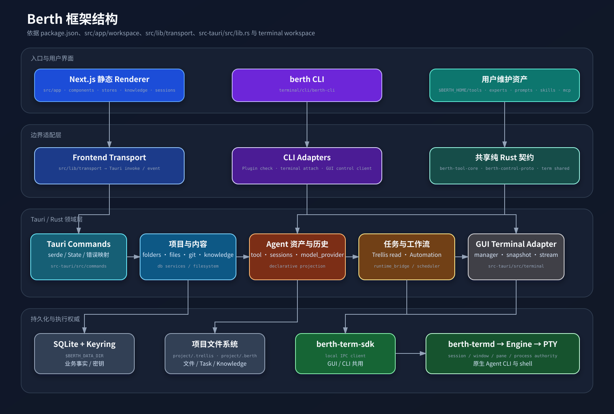
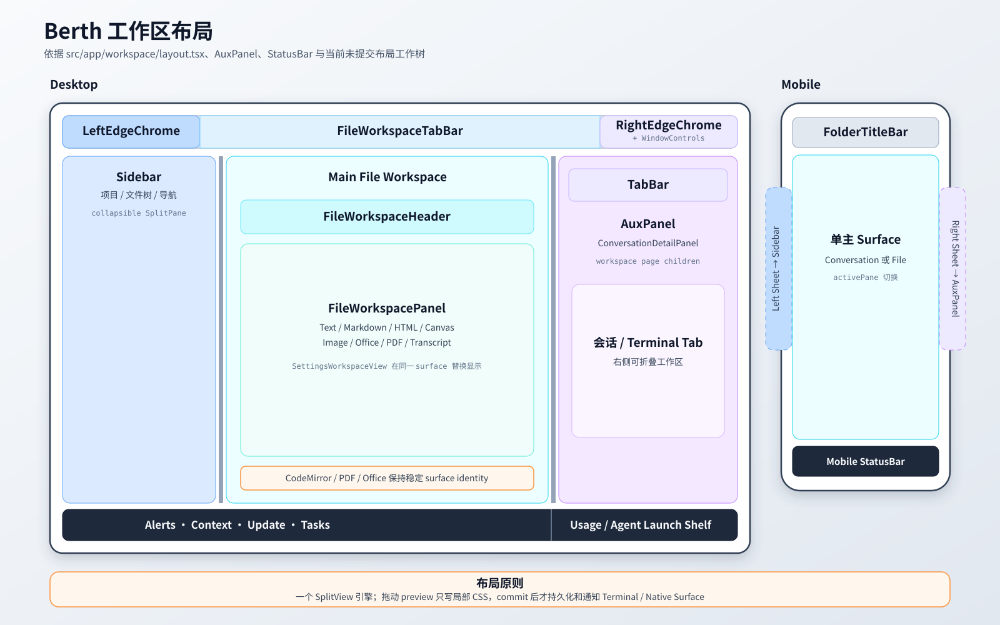
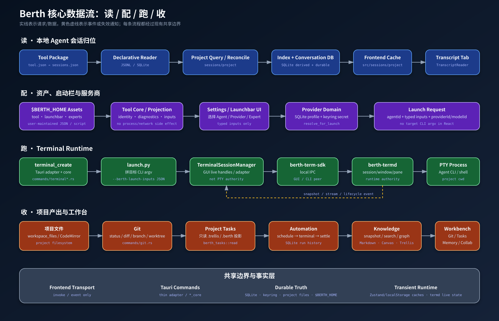

# Berth 当前架构与数据流

> 核验基线：2026-09-21 当前工作树；项目只读连接边界于 2026-09-22 复验更新。本文描述“现在如何运行”，不是路线图。
> 产品取舍、禁止事项与验证纪律以 `AGENTS.md` 为准；历史删除只查
> `docs/REMOVED.md`。

## 1. 产品边界

Berth 是一个本地桌面工作台：项目是容器，Agent 在项目目录里的原生 CLI/PTY 中工作。
产品循环是读取本地会话、选择资产与启动参数、运行 CLI、把文件/Git/任务/知识产出收回项目。

当前明确不是：生产 Web/server、ACP GUI 对话客户端、Chat Channels 客户端、Agent
品牌配置中心、内置 Skills/MCP 管理矩阵或第二套终端生命周期。

## 2. 技术栈与运行单元

| 层 | 当前实现 | 事实入口 |
|---|---|---|
| 前端 | Next.js 16、React 19、静态导出、next-intl、Zustand | `package.json`、`next.config.ts`、`src/` |
| 桌面壳 | Tauri 2 | `src-tauri/tauri.conf.json`、`src-tauri/src/lib.rs` |
| Rust 领域 | Rust 2021、Tokio、SeaORM、SQLite | `src-tauri/Cargo.toml`、`src-tauri/src/` |
| 终端 | `berth-termd` daemon + SDK + GUI/CLI adapters | `src-tauri/terminal/` |
| Tool 核心 | 纯 Rust `berth-tool-core` | `src-tauri/tool/berth-tool-core/` |
| 项目核心 | 纯 Rust `berth-project-core`（实体 + 迁移 owner + 数据实例解析 + 项目领域服务） | `src-tauri/project/berth-project-core/` |
| GUI 控制协议 | 零 IO DTO/codec crate | `src-tauri/control/berth-control-proto/` |



Next 使用 `output: "export"`，生产前端输出到 `out/`，由 Tauri `frontendDist` 加载。
`src/lib/transport/detect.ts` 将普通浏览器判为 `unsupported`，生产产品只有桌面 transport。

## 3. 仓库结构

```text
.
├── AGENTS.md                    # 产品主线、红线、工作流
├── CLAUDE.md                    # Claude Code 指向 AGENTS.md 的薄入口
├── docs/
│   ├── README.md                # 项目说明与文档地图
│   ├── architecture.md          # 当前架构与数据流
│   ├── diagrams/                # 源码驱动的 SVG 图
│   └── ...                      # 专项契约、验证、删除历史
├── src/                         # Next 静态前端
├── src-tauri/
│   ├── src/                     # GUI Rust crate
│   ├── project/                 # 项目持久化核心 crate（berth-project-core）
│   ├── tool/                    # Tool core crate
│   ├── control/                 # GUI control 协议 crate
│   └── terminal/                # shared / daemon / sdk / cli
├── .trellis/spec/               # 修改模块前读取的可执行契约
├── .berth/tasks/                # 任务 prd（`berth task` 写；旧 `.trellis/tasks` 只读退回）
└── .agents/skills/              # 项目级 Agent skills
```

`out/`、`node_modules/`、`src-tauri/target/`、`outputs/` 是生成物或本机构建物，不是架构事实来源。

配套图：

- [框架结构图](./diagrams/framework.svg)
- [工作区布局图](./diagrams/workspace-layout.svg)
- [核心数据流图](./diagrams/data-flow.svg)

## 4. 桌面启动

```text
src-tauri/src/main.rs
  ├─ --credential-helper → git_credential::run_credential_helper() → 退出
  └─ 普通启动 → berth_lib::run()
```

`src-tauri/src/lib.rs` 的 setup 建立日志、平台 PATH/Tauri plugins、TerminalManager、
工作区资源 manager、有效 `BERTH_DATA_DIR`、SQLite/migrations、GUI control socket、
automation scheduler、代理/日志/窗口设置和主窗口，最后注册 commands。

生产 Tauri state 是分别 `manage()` 的 `AppDatabase`、`TerminalManager`、窗口状态等。
`src-tauri/src/app_state.rs` 的 `AppState` 主要是共享测试构造边界，不能据此推断生产运行时
由一个全局 `AppState` 承载。

### 路径

| 数据 | 根目录 | 解析入口 |
|---|---|---|
| tools、experts、prompts、skills、mcp 等用户资产 | `$BERTH_HOME`，默认 `~/.berth` | `src-tauri/src/platform/paths.rs` |
| SQLite、uploads、logs、cache | `$BERTH_DATA_DIR` 或 Tauri app data | `src-tauri/src/platform/paths.rs` |
| Trellis、knowledge 等项目状态 | 项目内 `.trellis/` / `.berth/` | 各领域模块 |

开发脚本允许 HOME 与 DATA 分离。禁止在其他模块手拼这些根目录。

## 5. 前端框架

### 路由与生命周期

`src/app/page.tsx` 将根路径替换到 `/workspace`。`src/app/layout.tsx` 安装 i18n、theme、
appearance 和桌面基础组件。`src/app/workspace/layout.tsx` 是工作区宿主：

```text
AppWorkspaceProvider
  → AppUiRuntime
  → GitCredentialProvider
  → ConversationRuntimeProvider
  → WorkspaceRuntimeHost
  → TabProvider
  → DocumentContextProvider
  → PointerProvider
  → FolderLayoutShell
```

业务状态主要在 Zustand；Provider/render-null runtime 负责订阅、初始化、持久化和清理。

### Workbench

`src/lib/workbench/catalog.ts` 是 page/panel 事实表：

- pages：只有 `settings`；
- settings panels：以 catalog 和 `src/components/settings/pages/index.tsx` 为准。

git / 任务（含协作）/ 记忆是侧栏视图（`useSidebarViewStore`），不是 workbench panel。

面板归属与顺序固定在 catalog（`WORKBENCH_LAYOUT`），不可移动/隐藏，也不持久化；
只有各 page 的当前选中面板存在进程内（`use-workbench-layout.ts`）。

### 状态所有权

| 状态 | 所有者 |
|---|---|
| folders / conversations / branch | `src/stores/app-workspace-store.ts` |
| primary tabs | `src/stores/tab-store.ts` + SQLite |
| file tabs / editor state | `src/stores/workspace-file-store.ts` + localStorage |
| pane placement | `src/stores/workspace-layout-store.ts` |
| terminal live state | `src/stores/terminal-runtime-store.ts` |
| sidebar / aux UI | `src/stores/app-ui-store.ts` + localStorage |
| workbench layout | `src/lib/workbench/layout-storage.ts` |

高频或非序列化对象留在局部 controller/runtime，不复制进全局 store。



## 6. 前后端边界

```text
React / Zustand action
  → src/lib/api.ts 或领域 facade
  → src/lib/transport/getTransport()
  → TauriTransport.call / subscribe
  → Tauri command
  → Rust core / service
  → SQLite / filesystem / keyring / process / terminal SDK
```

`src/lib/transport/tauri-transport.ts` 是业务 `invoke` / event adapter。业务模块不得用
HTTP `fetch` 或直接 `invoke` 绕过它。

Rust command 的目标形态是 serde 参数与 Tauri State → `*_core` 普通引用 → 领域/service →
`AppCommandError`。公开 command 注册表位于 `src-tauri/src/lib.rs`，它是稳定 IPC 契约。

## 7. 核心数据流



### 7.1 打开项目

```text
UI
  → src/lib/api.ts::openFolder/openFolderInWorkspace
  → commands/folders.rs
  → berth_project_core::service::folder_service（共享项目领域服务）
  → SQLite folders
  → folder://changed 或 folder://open-in-workspace
  → AppWorkspaceProvider / WorkspaceOpenFolderListener
  → app-workspace-store / tab-store
  → workspace shell
```

`berth project ls`（CLI）走同一 service 的只读投影，不经过 GUI control：

```text
berth project ls → berth-project-core::instance（数据实例解析）
                 → berth-project-core::open::open_or_upgrade（ExistingOnly，只读开库）
                 → berth-project-core::service::folder_service
```

`AppWorkspaceProvider` 启动时只加载 folder 列表。Agent 历史不是启动必扫项。

### 7.2 Tool 与 Agent 发现

```text
$BERTH_HOME/tools/<id>/tool.json
  → berth-tool-core parser/repository
  → src-tauri/src/tool/ adapter
  → agent identity / provider declaration / sessions resource
  → launchbar、Tools、model provider、session reader 等消费方
```

普通工具与 Agent 使用同一协议；`identity.roles` 决定是否投影为 Agent。未知字段由开放
JSON 投影保留，局部错误形成 diagnostics。

GUI 的 Tools 页面经 `tool_assets` command 只读资产、`research.md` 和 `usage.md`，不执行
action。Tool action 的 CLI 执行面在 `berth-cli/src/tools/`。

### 7.3 Agent 启动

```text
status bar / conversation terminal action / launchbar UI
  → launchbar command 读取 tools/<id>/launchbar.json
  → 前端收集 typed inputs
  → createAndOpenPrimaryTerminalDetailed()
  → terminal_create
  → 可选 model_provider::injection
  → berth-cli tools launch tools/<id>/launch.js --berth-launch-inputs <json>
  → berth-term-sdk → berth-termd → PTY → 原生 Agent CLI
```

同一 JSON 也写入 `BERTH_LAUNCH_INPUTS`。React/Rust 不拼目标 Agent argv。
`tool.json` action plan 与桌面 Agent `launch.js` 是两个入口，不得互相回退。

### 7.4 模型服务商

```text
Settings / launchbar
  → model provider commands
  → SQLite provider rows + keyring secret
  → model_provider::injection::resolve_for_launch
  → tool.json providerInjection
  → env + provider extra args
  → terminal_create → launch.js
```

Tool parser 只投影声明，不访问 keyring 或网络。

### 7.5 终端

```text
TerminalView / terminal-runtime-store
  → terminal_* frontend API
  → commands/terminal_tauri.rs
  → commands/terminal.rs core
  → src-tauri/src/terminal/TerminalSessionManager
  → berth-term-sdk → local IPC → berth-termd → engine → PTY
```

Daemon 拥有 session/window/pane/PTY。GUI manager 只维护 live handle/index 和 Tauri channel
adapter。高频输出通过 `terminal_attach_channel` 二进制 packet 进入前端；CLI 也直接使用
SDK，因此 GUI 与 CLI 能发现同一个 daemon 会话。

### 7.6 会话历史读取

```text
tools/<id>/tool.json
  → org.berth.agent.sessions resource
  → package 内 sessions.json
  → sessions/declarative.rs（JSONL / 普通 SQLite）
  → sessions/project provider + query + index + reconcile
  → project_agent_session_index / conversations
  → list_project_agent_sessions
  → src/sessions/project cache/hook
  → resolve_project_agent_session
  → transcript file tab
  → get_conversation
  → src/sessions/components/TranscriptReader
```

声明类型、selector 取值与消息角色判定在 `berth-tool-core/src/sessions.rs`，
`sessions/declarative.rs` 与 CLI `berth session last`（`berth-cli/src/session.rs`，
某 Agent 在某目录最新会话的最后一条 assistant 文本，读 JSONL 与 JSON 文档）共用。

关键规则：只读有效声明；无声明时明确不支持；列表有界分页；已发现摘要可写入 session
index；reconcile 合并 native identity 与 SQLite conversation，并保留用户锁定标题。

`src/components/project-management/session-management/` 当前没有生产挂载点，不能当作项目
workbench 的活跃 panel。真实 transcript 展示入口是 file workspace tab。

### 7.7 Project tasks 与 Automation

```text
项目任务（GUI 与 CLI `berth task` 同一实现）：
UI → runtime_bridge_operation（task.list / task.views / task.view / berth.status）
   → berth_project_core::tasks → 项目 .berth/tasks（无任务时只读退回 .trellis/tasks）

Automation：
UI → automations command → automation_service / SQLite
   → 手动或 deadline scheduler → create_terminal_core
   → Agent launch.js / termd
   → scheduler 观察 inventory + exit snapshot → settle_run
```

任务读取不执行 Trellis CLI，也不写 `.trellis/`。Automation 进程退出 0 只表示执行正常结束，
用户验收状态另行记录。

### 7.8 知识库

```text
berth-memory panel
  → src/knowledge/api/knowledge-client.ts
  → runtime_bridge_operation(method = knowledge.*)
  → knowledge::dispatch / service
  → 项目 Markdown、.berth/knowledge、.trellis/spec、.trellis/tasks、
    .berth/tasks、memory
  → snapshot / search / graph
```

外部 CodeGraph/GitNexus 是可选 provider；失败不改变本地知识库的基本可用性。

### 7.9 文件阅读与编辑

```text
file tree / open request
  → workspaceRuntime
  → workspace-file-store
  → workspace_files commands
  → filesystem
  → FileWorkspacePanel → file viewer
```

文本进入 CodeMirror；PDF、Office、Image、HTML、Excalidraw 画板共享 file workspace tab 和
Header/runtime seam。详细分类见 `.trellis/spec/frontend/file-viewers.md`。

### 7.10 CLI 请求桌面动作

```text
berth CLI
  → berth-control-proto JSON-RPC line protocol
  → src-tauri/src/control local socket
  → shared folder/file core
  → workspace events
  → main window claim / complete
```

当前方法包括 hello、GUI status、project add、file open。`project ls` 已改为 CLI 直连共享
项目 crate（GUI 未运行也可用，见 §7.1），只读探测不拉起 GUI。
该通道与 terminal daemon IPC 完全独立。

## 8. 数据存储

| 存储 | 内容 |
|---|---|
| SQLite | folders、conversations、tabs、automations、model providers、session index 等 |
| keyring | provider/Git 等敏感密钥 |
| localStorage | UI panel、workbench layout、文件 tab 等客户端偏好 |
| `$BERTH_HOME` | Tool/Expert/Prompt/Skill/MCP 用户资产 |
| 项目 `.trellis/` | specs（旧 tasks 只读退回） |
| 项目 `.berth/` | knowledge 等项目状态 |
| termd 内存/IPC | live session/window/pane/PTY |

SQLite 启动时先用单连接顺序执行 migration，再建立 runtime pool；已执行 migration 只能追加。
迁移 owner 是 `src-tauri/project/berth-project-core/`：GUI 的 `db::init_database`（先完成 pending
restore）与 CLI 的 `project ls` 都调用同一 `open::open_or_upgrade` 切口，任一侧都不得复制
SQL、迁移清单或 DTO。CLI 使用 `ExistingOnly`，从连接层强制 `mode=ro`，不设置 WAL、
不迁移、不进入 GUI 写连接池；旧 schema 报 `UpgradeRequired` 并指向 GUI，
缺库报 `Missing`。GUI 使用 `CreateIfMissing`，保留迁移与写连接池生命周期。数据实例（数据根 + 库文件名）由 `instance` 模块解析：`BERTH_DATA_DIR`
显式给 CLI 时按目录内实际存在的库判定，两个候选库并存则要求 `BERTH_DATA_FILE`，否则报歧义；
GUI 仍由 `db::database_file_name()` 提供库名，不声称 GUI 也消费了该 CLI 覆盖变量。

## 9. 事件与可靠性

`src-tauri/src/event_bridge.rs` 定义 folder、conversation、tabs、workspace、terminal、
automation、logs 等事件。事件是失效通知或流通道，不替代持久化事实。需要冷启动可靠性
的动作必须有 claim/snapshot/reload 路径，不能只依赖“刚好订阅到了事件”。

## 10. 高风险边界

- `src-tauri/src/lib.rs`：启动顺序与公开 command；
- `src-tauri/src/platform/paths.rs`：HOME/DATA 路径；
- `src-tauri/src/event_bridge.rs`：跨窗口事件；
- `src-tauri/src/sessions/`：reader、索引和 identity reconcile；
- `src-tauri/project/berth-project-core/src/migration/`：不可逆历史；
- `src-tauri/src/platform/keyring_store.rs`、`model_provider/secrets.rs`：密钥；
- `src-tauri/src/terminal/`、`src-tauri/terminal/`：daemon/SDK/PTY；
- `src/lib/transport/`：唯一业务 IPC；
- `src/app/workspace/layout.tsx`：持久 surface 与全局 lifecycle；
- `src/lib/workbench/catalog.ts`：当前页面/panel 事实表。

## 11. 文档可信度

1. `AGENTS.md`：长期产品规则、红线和路由。
2. 本文：当前架构与数据流，必须给出源码入口。
3. `.trellis/spec/`：修改具体模块时的细粒度契约。
4. `.berth/tasks/`：阶段任务，不自动代表当前实现。
5. `docs/REMOVED.md`：历史；其中路径默认已经不存在。
6. README：当前用户可完成路径，不承担内部设计。
7. 无法定位到当前 source、test 或 manifest 的架构声明，应删除、标为待核验或移入任务，
   不得用推测补全。
